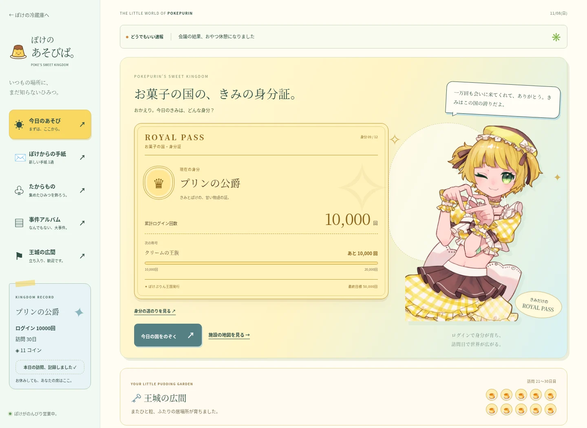
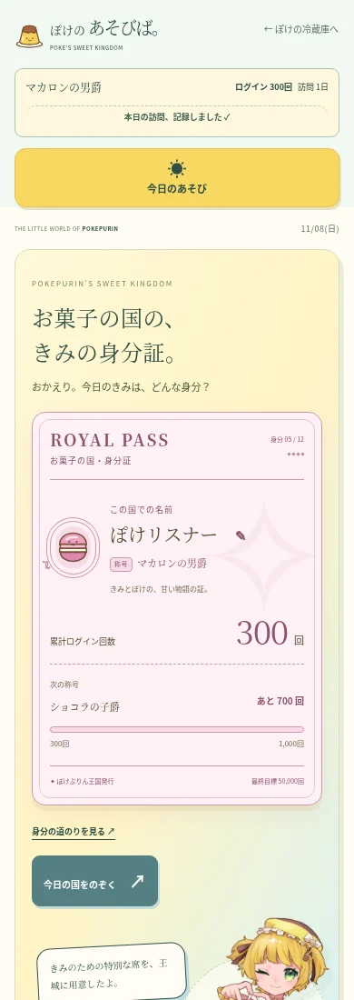
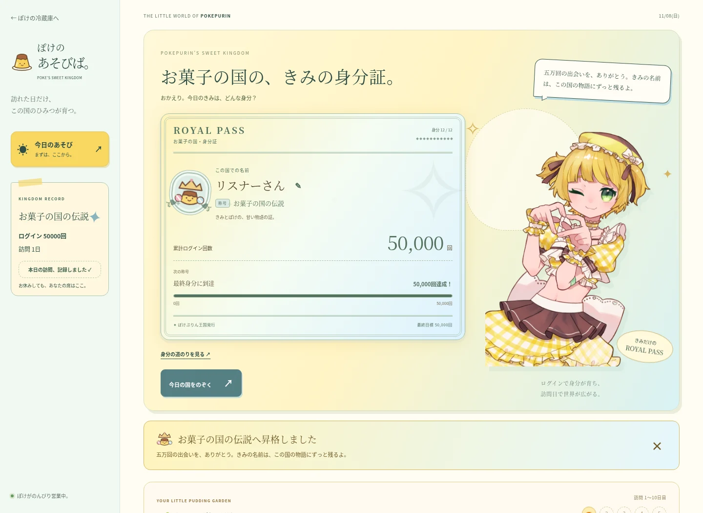

# ROYAL PASS — お菓子の国の身分昇格システム

レビュー用の変更です。mainへのマージ・GitHub Pagesへの本番公開は行っていません。

## 見た目

画像の回数は検証用の値で、利用者の本来の進捗は変更していません。

既存の丸いカード・Kiwi Maru・ぽけの画像を使い、黄色・水色・クリーム色の明るい身分証を主役にしました。

## お菓子と一致する名前プレート

基本のレイアウトは保ち、称号に含まれるお菓子を左側の小さなSVGイラストにしました。右側にユーザー名、その下に称号を置き、枠と配色も同じモチーフでそろえています。昇格するほど細枠・宝石・月桂樹が増えます。

| 称号 | モチーフ |
| --- | --- |
| キャンディの国民 | キャンディ |
| クッキーの菓子職人 | クッキー |
| ビスケットの騎士 | ビスケット |
| マカロンの男爵 | マカロン |
| ショコラの子爵 | チョコレート |
| タルトの伯爵 | フルーツタルト |
| パフェの侯爵 | パフェ |
| プリンの公爵 | プリン |
| クリームの王族 | ホイップクリーム |

名前は鉛筆ボタンで変更できます。実際のページでは名前専用の保存キーだけを使い、既存の進捗・手紙・季節イベントの記録には触れません。お試し版の名前は保存されません。

## 2種類の進行

| 項目 | 使用する値 | 変わるもの |
| --- | --- | --- |
| 身分昇格 | 累計ログイン回数 | 称号・身分証の色・紋章・ぽけのセリフ・昇格演出 |
| 施設と物語 | 累計訪問日数、日本時間の日付・時間 | 手紙、王城の広間、広場、休憩室、模様替え、物語の荷物、深夜の演出 |

施設をログイン回数と訪問日数の両方で制限する判定はありません。例えば50,000ログイン／訪問1日では最終身分でもポストは閉じたままです。1ログイン／訪問250日では旅人のまま施設が使えます。

## 身分の道のり

| 累計ログイン | 称号 | 演出 |
| ---: | --- | --- |
| 0 | お菓子の国の旅人 | クッキーの紋章 |
| 10 | キャンディの国民 | 小さなきらめき |
| 30 | クッキーの菓子職人 | 紋章のスタンプ |
| 100 | ビスケットの騎士 | リボンの輝き |
| 300 | マカロンの男爵 | 花びら |
| 1,000 | ショコラの子爵 | 紋章のスタンプ |
| 3,000 | タルトの伯爵 | 星 |
| 5,000 | パフェの侯爵 | リボンの輝き |
| 10,000 | プリンの公爵 | 王冠 |
| 20,000 | クリームの王族 | オーロラ |
| 30,000 | お菓子の国の守護者 | 星 |
| 50,000 | お菓子の国の伝説 | 星座とオーロラ |

昇格時も自動で画面全体を塞ぎません。回数が1増えただけの通常更新には演出を出しません。再読み込みや初回移行で過去の演出を連続再生しません。動きを減らす設定では紙吹雪を出さず、文章だけで知らせます。

## 保存互換性

- `poke-play-v1` と入場セッションの仕様・保存キーを維持しています。
- ログイン数、訪問日数、実績、選んだ名札、記念品、物語の記録は保持します。
- 旧名称は画面だけで読み替えます。バックアップ内の元の値は書き換えません。
- 季節イベントの保存コード・ニックネームは身分証から読み書きしません。
- 進捗・手紙それぞれのバックアップを維持し、読み戻しもブラウザで確認しています。

## レビューで試すこと

ローカルHTTPサーバーで `play.html` を開きます。`play.html?preview=1` のページ下部では、ログイン回数と施設用の訪問日数を独立して指定できます。50,000回の最終身分と、低い身分／高い訪問日数の組み合わせを確認できます。プレビュー内の「この身分の昇格演出を試す」は通常の保存記録を変更しません。

## 検証

- `node --test tests/*.test.mjs`：既存の手紙・実績・季節イベント・サーバー・共有集計、および追加した身分・保存互換性テスト。
- `node tests/royal.browser.cjs`：Chromiumで全称号、施設の独立判定、昇格の重複防止、旧データ、手紙の返信、バックアップ読み戻し、12月の表示、PCと390px・320pxのレイアウトを確認。
- ブラウザテストでは外部APIを遮断し、本番の季節イベントや応援数には書き込みません。共有APIの通信・重複制限は既存の単体／統合テストで確認しています。

### モチーフ更新の追加検証

- 全12段階の称号・モチーフ・枠と、段階的に増える装飾をChromiumで確認。
- 名前の変更・再読み込み・HTML文字の無害化・保存できない環境でも既存の進捗が変わらないことを確認。
- 20文字の名前を含む390px・320px表示で横はみ出しがないことを確認。
- 単一HTMLのお試し版で、名前と称号を切り替えてもブラウザの記録を読み書きしないことを確認。
